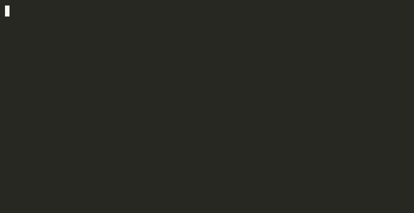

# termui

**Build agent-style terminal apps in Ballerina: streaming output, a live region, and approval prompts that stay well-behaved in pipes and CI.**

[](https://github.com/ayeshLK/module-termui/actions/workflows/ci.yml)
[](LICENSE)
[](https://central.ballerina.io/ayesha/termui/0.1.0)
[](https://github.com/ayeshLK/module-termui/releases)




<sub>The [agent demo](examples/agent-demo), recorded from the real program: interactively, with its output redirected, and with no terminal at all.</sub>

> **Status: experimental (0.1).** The API can still change before 1.0. macOS and Linux only.

## Why termui

- **Inline, not full-screen.** A small live region (a spinner, a status line, a prompt) is redrawn in place at the bottom. Finished output is written once into your normal scrollback, so it stays selectable, searchable and in your terminal's history.
- **Safe in pipes and CI.** The same program runs interactively, with its output redirected, and with no terminal at all. Results go to standard output and nothing else does; questions never wait for input that cannot come; headless output is plain and repeatable.
- **Testable without a terminal.** A `FakeTerminal` with a small virtual screen lets you script keys and assert on what was drawn, including reflow on resize.
- **Concurrency the compiler checks.** Your program's state lives on one strand. Effects are `isolated` functions that report back with immutable messages, and a mutable message or a non-isolated effect does not compile.
- **Pure Ballerina.** No Java code to ship, and it builds as a GraalVM native image.

## Quickstart

termui is on [Ballerina Central](https://central.ballerina.io/ayesha/termui/0.1.0). Import it and Ballerina fetches it on the next build; to pin a version, add it to your package's `Ballerina.toml`:

```toml
[[dependency]]
org = "ayesha"
name = "termui"
version = "0.1.0"
```

A counter, in `main.bal` ([`examples/counter`](examples/counter) is this file, built in CI):

```ballerina
import ayesha/termui;
import ayesha/termui.term;
import ayesha/termui.text;

class Counter {
    *termui:Program;

    int count = 0;

    public function update(termui:Message message) returns termui:Command? {
        if message is term:KeyEvent {
            if message.key == "+" {
                self.count += 1;
            } else if message.key == "-" {
                self.count -= 1;
            } else if message.key == "q" {
                return termui:quit();
            }
        }
        return ();
    }

    public function view() returns text:Span[][] {
        return [
            [{text: "count: " + self.count.toString(), style: {bold: true}}],
            [{text: "+ and - change it, q quits", style: {dim: true}}]
        ];
    }
}

public function main() returns error? {
    termui:Interface ui = new (term:detectEnvironment());
    check ui.run(new Counter());
}
```

Run it with `bal run` and press `+`, `-` and `q`. Requires Ballerina 2201.14 and JDK 25.

## How it works

```
 keys, resizes, timers, effect results ──> message queue ──> loop ──> update(message) ──> command
                                                               │
                                                               └──> view() ──> one frame per batch
```

You write a `Program` with two methods: `update` is called for each message and returns what to do next (`quit()`, start an `effect`, `commitProse` some finished output, and so on), and `view` returns the live region as lines of styled text. The runtime applies every waiting message, then draws **one** frame, writing only the cells that changed. Work that takes time runs in an effect on its own strand and reports back with messages, so the interface never blocks.

| Module | What it is for |
|---|---|
| [`ayesha/termui`](ballerina/Module.md) | The runtime: `Program`, `run`, messages, commands, effects, prompts, `Interface` |
| [`ayesha/termui.term`](ballerina/modules/term/Module.md) | The terminal: `UnixTerminal`, `FakeTerminal`, input events, environment detection |
| [`ayesha/termui.render`](ballerina/modules/render/Module.md) | Drawing: the inline renderer, the plain renderer, the cell buffer |
| [`ayesha/termui.text`](ballerina/modules/text/Module.md) | Styled text, display width (CJK, emoji, combining marks), wrapping |

## Examples

| Example | Shows |
|---|---|
| [`examples/counter`](examples/counter) | The smallest interactive program (the quickstart above); clone the repo and `bal run` in the folder |
| [`examples/agent-demo`](examples/agent-demo) | An agent-style app: streamed text, a spinner and status line, an approval prompt, a result on standard output. Run it three ways, as in the recording above |

## Documentation

- **[Package guide](ballerina/Package.md):** the modes (interactive, piped output, piped input, headless), what each guarantees, and the plain-output rules.
- **Module references:** the four `Module.md` files linked above.
- **[Specifications](openspec/specs):** the behavior the library promises, as testable requirements and scenarios.
- **[Design notes](openspec/changes/archive):** why it is built the way it is, including measurements (startup time, write throughput) and what was tried.

## Status and limits

Worth knowing before you build on it:

- **Experimental.** Expect API changes before 1.0.
- **Platforms:** macOS and Linux. Windows is not supported.
- **Startup:** about 0.3 s to the first frame on the JVM (334 ms for the agent demo on a developer laptop) and about 0.23 s with an AppCDS archive. The Ballerina runtime is most of that. Long-lived interactive programs will not notice; a command you run a hundred times a day might.
- **Resize:** committed output is not re-laid out; terminals that re-wrap text do it for prose, and blocks keep the width they were written at. The renderer needs to be told whether your terminal re-wraps (`reflow`).
- **Not there yet:** ready-made widgets (text editor, select list, spinner), incremental markdown rendering, a bridge to Ballerina's AI module, and JSON output for headless mode.

## Contributing

Issues and pull requests are welcome. [CONTRIBUTING.md](CONTRIBUTING.md) covers building, the test groups, the native-image check, and releasing.

## License

Apache License 2.0. See [LICENSE](LICENSE).
