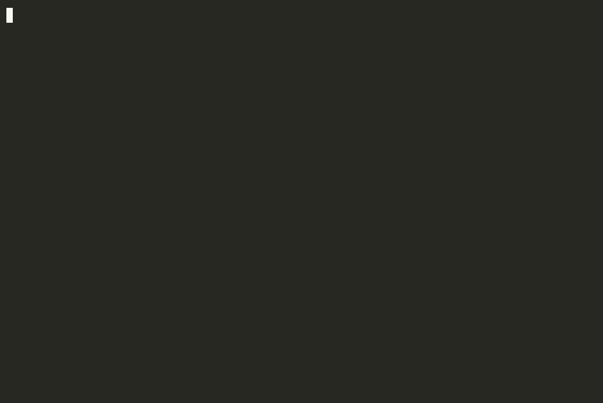
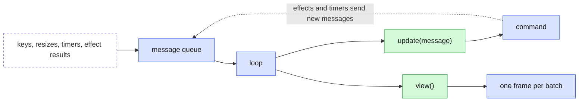

<h1 align="center">termui</h1>

<p align="center">
  <a href="https://github.com/ayeshLK/module-termui/actions/workflows/ci.yml"></a>
  <a href="LICENSE"></a>
  <a href="https://central.ballerina.io/ayesha/termui/1.0.0"></a>
  <a href="https://github.com/ayeshLK/module-termui/releases"></a>
  
  
</p>

<br>

<p align="center">
  <b>A general-purpose terminal UI library for Ballerina.</b>
</p>

<p align="center">
  
</p>

<p align="center">
  <sub>The <a href="examples/agent-harness">agent harness</a>, recorded from the real program: a prompt with history, a streamed answer with a colored code block, tool calls, and two approval prompts.</sub>
</p>

> **Status: stable.** The API follows [semantic versioning](COMPATIBILITY.md). macOS and Linux only.

## Why termui

- **Inline, not full-screen.** A small live region (a spinner, a status line, a prompt) is redrawn in place at the bottom. Finished output is written once into your normal scrollback, so it stays selectable, searchable and in your terminal's history.
- **Safe in pipes and CI.** The same program runs interactively, with its output redirected, and with no terminal at all. Results go to standard output and nothing else does; questions never wait for input that cannot come; headless output is plain and repeatable.
- **Testable without a terminal.** A `FakeTerminal` with a small virtual screen lets you script keys and assert on what was drawn, including reflow on resize.
- **Concurrency the compiler checks.** Your program's state lives on one strand. Effects are `isolated` functions that report back with immutable messages, and a mutable message or a non-isolated effect does not compile.
- **Pure Ballerina.** No Java code to ship, and it builds as a GraalVM native image.

## Quickstart

termui is on [Ballerina Central](https://central.ballerina.io/ayesha/termui/1.0.0). Import it, and the first `bal build` fetches the latest release and records its version in `Dependencies.toml`. Later builds keep that version as a minimum, pick up newer patch releases on their own, and move to a newer minor release only when you ask. [COMPATIBILITY.md](COMPATIBILITY.md) says what each kind of release may change.

A counter, in `main.bal` ([`examples/counter`](examples/counter) is this file, built in CI):

```ballerina
import ayesha/termui;
import ayesha/termui.term;
import ayesha/termui.text;

class Counter {
    *termui:Program;

    int count = 0;

    public function update(termui:Message message) returns termui:Command? {
        if message is term:KeyEvent {
            if message.key == "+" {
                self.count += 1;
            } else if message.key == "-" {
                self.count -= 1;
            } else if message.key == "q" {
                return termui:quit();
            }
        }
        return ();
    }

    public function view() returns text:Span[][] {
        return [
            [{text: "count: " + self.count.toString(), style: {bold: true}}],
            [{text: "+ and - change it, q quits", style: {dim: true}}]
        ];
    }
}

public function main() returns error? {
    termui:Interface ui = new (term:detectEnvironment());
    check ui.run(new Counter());
}
```

Run it with `bal run` and press `+`, `-` and `q`. Requires Ballerina 2201.14 and JDK 25.

## How it works



Blue steps are the termui runtime, green steps are your program, and the dashed box is outside the program.

You write a `Program` with two methods: `update` is called for each message and returns what to do next (`quit()`, start an `effect`, `commitProse` some finished output, and so on), and `view` returns the live region as lines of styled text. The runtime applies every waiting message, then draws **one** frame, writing only the cells that changed. Work that takes time runs in an effect on its own strand and reports back with messages, so the interface never blocks.

| Module | What it is for |
|---|---|
| [`ayesha/termui`](ballerina/Module.md) | The runtime: `Program`, `run`, messages, commands, effects, prompts, `Interface` |
| [`ayesha/termui.term`](ballerina/modules/term/Module.md) | The terminal: `UnixTerminal`, `FakeTerminal`, input events, environment detection |
| [`ayesha/termui.render`](ballerina/modules/render/Module.md) | Drawing: the inline renderer, the plain renderer, the cell buffer |
| [`ayesha/termui.text`](ballerina/modules/text/Module.md) | Styled text, display width (CJK, emoji, combining marks), wrapping |
| [`ayesha/termui.input`](ballerina/modules/input/Module.md) | A text input: `LineEditor` with cursor movement, word editing, multi-line, paste, history |

## Examples

| Example | Shows |
|---|---|
| [`examples/agent-harness`](examples/agent-harness) | **A Claude-Code-style agent harness with a scripted "model":** a prompt with line editing and history, streamed answers with colored code blocks, tool calls with approval prompts, a status line with elapsed time and tokens, and Esc to interrupt (the recording at the top) |
| [`examples/counter`](examples/counter) | The smallest interactive program (the quickstart above); clone the repo and `bal run` in the folder |

## Documentation

- **[Documentation site](https://ayeshlk.github.io/module-termui/):** how the pieces work (the update and view loop, commands, inline rendering, modes, the line editor), best practices (strands and isolation, testing, compatibility), and a tutorial that builds a small agent harness step by step.
- **[Package guide](ballerina/Package.md):** the modes (interactive, piped output, piped input, headless), what each guarantees, and the plain-output rules.
- **Module references:** the `Module.md` files linked above.
- **[Compatibility and versioning](COMPATIBILITY.md):** what is public API, what a patch, minor or major release may change, how deprecation works, and the supported platforms.
- **[Changelog](CHANGELOG.md):** what changed in each release, with migration notes.
- **[Specifications](openspec/specs):** the behavior the library promises, as testable requirements and scenarios.
- **[Design notes](openspec/changes/archive):** why it is built the way it is, including measurements (startup time, write throughput) and what was tried.

## Status and limits

Worth knowing before you build on it:

- **Stable.** Breaking changes only in a new major version; see [COMPATIBILITY.md](COMPATIBILITY.md).
- **Platforms:** macOS and Linux. Windows is not supported.
- **Startup:** about 0.3 s to the first frame on the JVM (334 ms for the agent demo on a developer laptop) and about 0.23 s with an AppCDS archive. The Ballerina runtime is most of that. Long-lived interactive programs will not notice; a command you run a hundred times a day might.
- **Wide lines:** a line of the live region wider than the terminal is cut off at the right edge, not wrapped. Wrap it with `text:wrap` first; the line editor does.
- **Resize:** committed output is not re-laid out; terminals that re-wrap text do it for prose, and blocks keep the width they were written at. The renderer needs to be told whether your terminal re-wraps (`reflow`).
- **Not there yet:** more ready-made widgets (select list, spinner), incremental markdown rendering, a bridge to Ballerina's AI module, and JSON output for headless mode.

## Contributing

Issues and pull requests are welcome. [CONTRIBUTING.md](CONTRIBUTING.md) covers building, the test groups, the native-image check, and releasing.

## License

Apache License 2.0. See [LICENSE](LICENSE).
